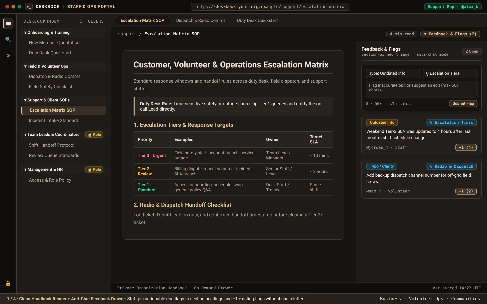
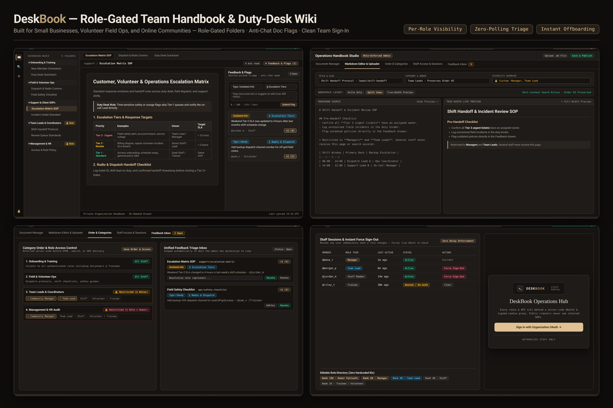

# DeskBook — Role-Gated Team Handbook & Operations Wiki

  

> [!IMPORTANT]
> **Public Project Showcase & Request Tracker**
> DeskBook is a production-proven internal operations binder built to solve real team coordination and access-control headaches at near-zero infrastructure cost. If you want to evaluate DeskBook for your organization or request a custom setup, **[open an Access / Evaluation Request](../../issues/new?template=access_request.yml)**.

---

## Why Teams Use DeskBook

Most growing organizations hit the same wall: **Google Docs becomes a maze of broken links, while Notion and Confluence quickly climb past \$10+/person/month.** Meanwhile, free wikis rarely let you lock sensitive folders to specific staff roles or collect document corrections without turning every page into a noisy chat channel.

**DeskBook** gives your team a fast, distraction-free duty-desk manual that plugs directly into the roles your team already uses—while costing pennies a month to run.

### Built for Real-World Teams Across Every Setting

| Team Type | How DeskBook Helps Day-to-Day |
| :--- | :--- |
| **Small Businesses & Support Teams** | Centralize SOPs, billing escalation matrices, and onboarding checklists while keeping manager HR notes locked behind role gates. |
| **Volunteer & Field Response Crews** | Keep dispatch protocols, radio comms procedures, and safety checklists clean and searchable at the duty desk, with trainees restricted from lead-only runbooks. |
| **Online Communities & Event Staff** | Organize moderation guidelines, appeals rules, and shift handoffs cleanly across Trial, Junior, Staff, Lead, and Manager tiers. |

---

## What It Does Out of the Box

| Capability | Practical Benefit for Staff & Leads |
| :--- | :--- |
| **Role-Gated Folders & Pages** | Every folder defaults to **All Staff**, or you can lock specific categories and individual pages to exact roles (e.g., *Managers Only*—hidden even from Team Leads). |
| **Anti-Chat "Feedback & Flags" Drawer** | Staff flag outdated or unclear rules pinned directly to a document section heading (`500` chars max). Others click **`+1`** instead of piling on replies, keeping pages focused. |
| **Unified Admin Feedback Inbox** | Managers and Leads triage open flags across all permitted documents in one queue, jump straight to edit the doc, and mark flags resolved with a short note. |
| **True-Width Markdown Studio & `.md` Dropzone** | Write, upload `.md` files with YAML frontmatter, collapse metadata drawers, and toggle **Write Only**, **Split View**, or **True-Width Preview** matching the live layout. |
| **Role Directory & Instant Force Sign-Out** | Label roles in plain English inside the dashboard and boot a departed member's active session in one click, forcing live role re-verification immediately. |

---

## Interested in Using or Evaluating DeskBook?

- **[Request Private Demo / Evaluation Access](../../issues/new?template=access_request.yml)** — Share your organization type and workflow needs.
- **[Ask a Question or Suggest a Feature](../../issues/new?template=feedback_or_bug.yml)** — Reach out directly via GitHub Issues.

---

**Copyright &copy; 2026 PNWcoastie. All Rights Reserved.**  
*DeskBook Showcase Repository. Proprietary source code resides in a separate private repository.*
